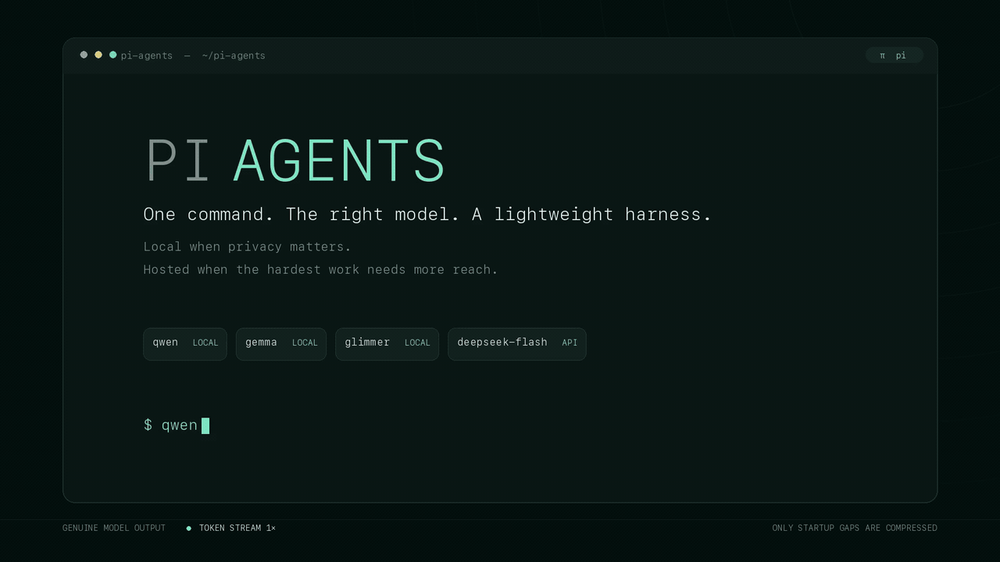

# Local and open-weight coding agents with Pi

[](./LICENSE)

Open-weight models can now reason over a repository, call shell and file tools, recover from failed actions and finish multi-step coding work on a developer's own machine, but a downloaded model is not yet an agent. Something has to start the right inference server with the right context size and chat template, point a harness at it, translate the harness's thinking levels into whatever that model actually accepts, and stop the server afterwards. This repository does that work on Apple Silicon Macs, for engineers who want local or inexpensive agents beside their hosted ones, so that choosing a model comes down to typing its name in a project directory:

```bash
deepseek          # difficult, high-stakes coding and reasoning (hosted)
deepseek-flash    # faster and cheaper hosted work
qwen              # strong general-purpose local coding agent
qwen-uncensored   # refusal-removed Qwen for controlled security research
glimmer           # local tool-driven and long-horizon agent work
gemma             # compact local reasoning and coding
nemotron          # fast local coding and tool use
```

Each command opens [Pi](https://github.com/earendil-works/pi), a minimal terminal coding harness, in the current directory and passes its arguments through to Pi. The five local commands start their inference server on demand and stop it when Pi exits, while the two DeepSeek commands call DeepSeek's hosted API. Pi, the inference servers and the models are other people's work; what lives here is the launcher, the Pi model configuration and a chat-template adapter that make them behave well together.

## Demo

[](./demo/pi-agents-intro.mp4)

The movie shows four of the seven commands: Qwen describes the setup, Gemma and Muse Glimmer introduce their local runtimes, and DeepSeek V4 Flash signs off with an ASCII wave. It is rendered rather than screen-recorded. [`capture_demo.py`](./demo/capture_demo.py) runs each command through Pi's JSON mode with tools disabled and records every text delta with its arrival time, and [`render_demo.py`](./demo/render_demo.py) draws a terminal around those streams. The model text and token timing are real. The prompts were scripted to tell each model what to say and appear on screen in a shorter form, and each wait before the first token is compressed, with the real wait labelled. Click the animation for the [higher-quality MP4](./demo/pi-agents-intro.mp4), or see [`demo/README.md`](./demo/README.md) to reproduce it.

## Why this exists

Local agents are not interchangeable with the strongest hosted models, but they are capable enough to earn distinct jobs in a normal development loop: exploring sensitive repositories and reviewing code on your own hardware, running repeated searches and mechanical changes without per-token cost, and providing a second implementation or review from a different model family.

Security engineering adds a sharper reason to keep them available, because legitimate work can trip the policy layer of a hosted coding agent before it has inspected any code. In our work, Claude Code and Fable can become close to unusable for security fixes, since a prompt as ordinary as "look at authentication decoding" can produce a refusal instead of an analysis. The local Qwen, Glimmer, Gemma and Nemotron routes do not pass the task through a hosted provider's policy gate, and DeepSeek has been materially less refusal-prone for this work. These models still have safety training and can still refuse, but they have remained available for ordinary defensive tasks such as tracing authentication, reviewing authorization boundaries, fixing token handling and validating a security patch.

The harness matters as much as the model, because it decides what context the model sees, which tools it can call and how the results come back. [Harness-Bench](https://arxiv.org/abs/2605.27922) found substantial differences across model-harness pairings in 5,194 trajectories, and [SWE-Bench Mobile](https://arxiv.org/abs/2602.09540) measured up to a sixfold gap for the same model across agents. Neither shows that the smallest harness always wins, but together they make a good argument for holding the harness fixed while you compare models. Pi suits that job: it provides an interactive terminal UI with persistent sessions, four default tools in `read`, `bash`, `edit` and `write`, and one provider layer for hosted APIs and local OpenAI-compatible servers, so a success or failure can be attributed to the model and its configuration before anyone reaches for planners, subagents or retrieval layers.

## Quick start on Apple Silicon

These steps assume a fresh macOS installation with [Homebrew](https://brew.sh/) and take you to a working agent on the smallest local model, Gemma, which needs about 7 GB of disk. The other models follow in step 6, because each command looks only for its own files and works as soon as they arrive. All five local models together take about 85 GB, and a Mac with at least 64 GB of unified memory is recommended for the configured context sizes.

### 1. Install Pi and the inference servers

```bash
brew install node llama.cpp uv
npm install -g --ignore-scripts @earendil-works/pi-coding-agent@0.84.2
uv tool install mlx-vlm --with huggingface-hub --with jinja2
export PATH="$HOME/.local/bin:$PATH"

pi --version
llama-server --version
mlx_vlm.server --help
```

Pi is pinned because this configuration targets 0.84.2 and a later release has changed a model id it relies on: Pi 1.5.0 lists `deepseek-flash` where the launcher asks for `deepseek-v4-flash`. `uv` installs `mlx_vlm.server` into `~/.local/bin`, which is also where the launcher goes, so that directory needs to be on your `PATH`. MLX-VLM serves only `qwen-uncensored` and the two DeepSeek commands need no inference server at all, so you can leave out what you will not use.

### 2. Install the launcher and configuration

```bash
git clone https://github.com/chrischabot/pi-local-agents.git
cd pi-local-agents

PI_AGENTS_DATA="${XDG_DATA_HOME:-$HOME/.local/share}/pi-agents"
mkdir -p "$HOME/.pi/agent" "$HOME/.local/bin" "$PI_AGENTS_DATA"

if [[ -e "$HOME/.pi/agent/models.json" ]]; then
  echo "Pi already has models.json; merge this repository's providers into it."
else
  cp ./models.json "$HOME/.pi/agent/models.json"
fi

install -m 755 ./pi-model "$HOME/.local/bin/pi-model"
install -m 644 ./templates/muse-glimmer-safe.jinja "$PI_AGENTS_DATA/muse-glimmer-safe.jinja"

for name in qwen qwen-uncensored glimmer gemma nemotron deepseek deepseek-flash; do
  ln -sf "$HOME/.local/bin/pi-model" "$HOME/.local/bin/$name"
done
```

If `~/.pi/agent/models.json` already exists, do not overwrite it. Merge the `providers` entries from this repository's [`models.json`](./models.json) into it by hand: the five `local-*` providers and the `deepseek` thinking overrides.

### 3. Download Gemma

The `--output` name is the one the launcher looks for, and the download resumes if you run the command again after an interruption.

```bash
PI_MODEL_DIR="${XDG_DATA_HOME:-$HOME/.local/share}/pi-models"
mkdir -p "$PI_MODEL_DIR"

curl --fail --location --retry 5 --continue-at - --progress-bar \
  --output "$PI_MODEL_DIR/gemma-4-12b-it-qat-q4_0.gguf" \
  "https://huggingface.co/google/gemma-4-12B-it-qat-q4_0-gguf/resolve/main/gemma-4-12b-it-qat-q4_0.gguf?download=true"
```

### 4. Add the commands and the DeepSeek key to your shell

Add these lines to `~/.zshrc`, or to `~/.bashrc` or `~/.bash_profile` if you use Bash, then reload the profile with, for example, `source ~/.zshrc`:

```bash
export PATH="$HOME/.local/bin:$PATH"
export DEEPSEEK_API_KEY="paste-your-api-key-here"
```

The key comes from the [DeepSeek API console](https://platform.deepseek.com/api_keys) and only the two DeepSeek commands need it. On a shared machine, keep it in a credential manager rather than a shell profile, and do not put it in `models.json`.

### 5. Run an agent

```bash
cd /path/to/project
gemma
```

The first local launch can take a while as the server maps the model and allocates its context. When Pi exits, the launcher stops the server it started. Pi runs with your user's permissions and is not sandboxed, even with a local model, so read the [security boundary](#security-boundary) before pointing it at anything sensitive.

### 6. Add the other models

Run whichever of these you want. Two of the local names differ from the publishers' current filenames because Unsloth and Meta have since renamed or replaced those builds. If another download returns a 404, the same thing has probably happened again: find the equivalent file on the publisher's page and keep the local name.

```bash
PI_MODEL_DIR="${XDG_DATA_HOME:-$HOME/.local/share}/pi-models"

# qwen
curl --fail --location --retry 5 --continue-at - --progress-bar \
  --output "$PI_MODEL_DIR/Qwen3.8-27B-Q4_K_M.gguf" \
  "https://huggingface.co/unsloth/Qwen3.8-27B-GGUF/resolve/main/Qwen3.8-27B-UD-Q4_K_M.gguf?download=true"

# glimmer
curl --fail --location --retry 5 --continue-at - --progress-bar \
  --output "$PI_MODEL_DIR/muse-glimmer-30B-kquant-dynamic.gguf" \
  "https://huggingface.co/meta-models/Muse-Glimmer-30B-GGUF/resolve/main/Muse-Glimmer-30B-KQuant-Dynamic-Q4_K_XL.gguf?download=true"

# nemotron
curl --fail --location --retry 5 --continue-at - --progress-bar \
  --output "$PI_MODEL_DIR/NVIDIA-Nemotron-3.5-Lightning-30B-A3B-Q4_0.gguf" \
  "https://huggingface.co/ggml-org/NVIDIA-Nemotron-3.5-Lightning-30B-A3B-GGUF/resolve/main/NVIDIA-Nemotron-3.5-Lightning-30B-A3B-Q4_0.gguf?download=true"
```

`qwen-uncensored` is different in kind, so read its [model card](https://huggingface.co/orcarouter/Qwen3.8-27B-Uncensored-MLX) before downloading it. The publisher has substantially removed the model's safety alignment, releases it strictly for research, and warns that it has no meaningful built-in guardrails and will comply with harmful or illegal requests. If you want it, this fetches the 6-bit MLX weights, about 23 GB:

```bash
PI_MODEL_DIR="${XDG_DATA_HOME:-$HOME/.local/share}/pi-models"

uvx --from huggingface-hub hf download \
  orcarouter/Qwen3.8-27B-Uncensored-MLX \
  --include "6-bit/*" \
  --local-dir "$PI_MODEL_DIR/Qwen3.8-27B-Uncensored-MLX"
```

If Hugging Face asks for access, accept the conditions on the model card and sign in with `uvx --from huggingface-hub hf auth login`.

## Choosing a command

| Command | Model | Runs on | Pi context | Start here to… |
| --- | --- | --- | ---: | --- |
| `deepseek` | [DeepSeek V4 Pro](https://api-docs.deepseek.com/news/news260424/) | DeepSeek's API | 1M | implement or review a security-sensitive feature, or debug an unfamiliar subsystem |
| `deepseek-flash` | [DeepSeek Flash](https://api-docs.deepseek.com/quick_start/pricing/) | DeepSeek's API | 1M | fix a contained bug or triage failing tests quickly and cheaply |
| `qwen` | [Qwen 3.8 27B](https://huggingface.co/Qwen/Qwen3.8-27B) | llama.cpp, port 18181 | 131,072 | work on private code with a strong general-purpose local model |
| `qwen-uncensored` | [Qwen 3.8 27B Uncensored](https://huggingface.co/orcarouter/Qwen3.8-27B-Uncensored-MLX), 6-bit | MLX-VLM, port 18185 | 131,072 | run controlled defensive research without model-level refusals |
| `glimmer` | [Muse Glimmer 30B](https://huggingface.co/meta-models/Muse-Glimmer-30B) | llama.cpp, port 18182 | 65,536 | follow a long chain of tool actions, such as tracing 25 commits through the code |
| `gemma` | [Gemma 4 12B](https://huggingface.co/google/gemma-4-12B-it) | llama.cpp, port 18183 | 65,536 | explain or edit a small, well-bounded area with the smallest local model |
| `nemotron` | [Nemotron 3.5 Lightning 30B-A3B](https://huggingface.co/nvidia/NVIDIA-Nemotron-3.5-Lightning-30B-A3B-BF16) | llama.cpp, port 18184 | 131,072 | run a fast private coding or tool-use loop on a model that activates about 3B of its 30B parameters per token |

These are starting points that follow how each developer positions its model, not independent benchmarks, and running `qwen` and then `deepseek` is a good way to get independent approaches from different model families. If a model repeatedly misuses a tool, loses the task across turns or cannot close its verification loop, switch models rather than piling on prompt scaffolding.

Three details change what you can expect from these routes. `deepseek-flash` requests the model id `deepseek-v4-flash`, which DeepSeek has retired but still accepts, serving those requests with V4.1 Flash. Both DeepSeek commands send your prompts and any tool output the agent returns to DeepSeek's servers. The llama.cpp routes load no vision projector and are text-only even where the model is multimodal, which leaves `qwen-uncensored` as the only local route that declares image input.

## Using it

Open an agent in any repository, then give it a concrete objective and a completion boundary:

```bash
cd /path/to/project
qwen
```

```text
Trace the authentication flow, implement the missing token rotation check,
run the focused tests, and report anything you could not verify.
```

Arguments go straight to Pi, so the rest of its interface works as usual, and [Pi's documentation](https://github.com/earendil-works/pi/blob/main/packages/coding-agent/docs/index.md) covers it in full:

```bash
# Run one task without opening the TUI
glimmer -p "Inspect the latest 25 commits. Group them by intent, explain the most important behavioral changes, and identify any unfinished follow-up."

# Set a thinking level
deepseek --thinking max
qwen --thinking high     # sends Qwen's xhigh
gemma --thinking off

# Restrict tools, skip the saved session, or list what is configured
gemma --tools read,bash -p "Explain why this build fails without editing files."
qwen --no-session
pi --list-models
```

## How it works

All seven commands are symlinks to [`pi-model`](./pi-model), a single Bash script that decides what to do from the name it was invoked under. The DeepSeek commands check for `DEEPSEEK_API_KEY` and hand over to Pi with the matching built-in model. A local command does more work:

1. It checks that the inference server and model files exist.
2. It asks the command's fixed loopback port whether the right model is already being served, and refuses to continue if a different inference server holds that port.
3. If nothing is listening, it starts llama.cpp, or MLX-VLM for `qwen-uncensored`, on `127.0.0.1` with Metal GPU offload and waits for the OpenAI-compatible endpoint to become ready.
4. It starts Pi with the matching provider and model from [`models.json`](./models.json), which this setup installs as Pi's standard `~/.pi/agent/models.json`.
5. When Pi exits, it stops the server if it started it. A server that was already running is reused and left running.

Server logs go to `${TMPDIR:-/tmp}/pi-local-models`. By default the launcher finds `pi`, `llama-server` and `mlx_vlm.server` on `PATH` and reads models from `${XDG_DATA_HOME:-$HOME/.local/share}/pi-models`. A standard installation needs no overrides, but `PI_BIN`, `LLAMA_SERVER_BIN`, `MLX_VLM_SERVER_BIN`, `PI_MODEL_DIR` and `GLIMMER_CHAT_TEMPLATE` change those locations, and `QWEN_MODEL_PATH`, `QWEN_UNCENSORED_MODEL_PATH`, `GLIMMER_MODEL_PATH`, `GEMMA_MODEL_PATH` and `NEMOTRON_MODEL_PATH` point at individual models.

### Thinking levels

Pi offers one set of thinking labels, but the models do not implement the same controls, so `models.json` maps each label to a value the selected model supports. `deepseek --thinking medium` shows `medium` in Pi's footer while sending DeepSeek's `high`, and `qwen --thinking high` sends Qwen's `xhigh`. Glimmer hides `off` because it has no reliable non-reasoning mode, and Gemma and Nemotron expose only a switch, so Pi offers `off` and `medium` for those two. The sampling defaults in the same file follow each model card.

### Hidden reasoning

The local routes do not replay hidden reasoning after a completed user turn, so that a mistaken intermediate thought, such as a hallucinated model identity, does not become persistent context. Visible answers, tool calls and tool results stay in the history, and reasoning inside the current tool-call chain is kept. Each model needs its own way of getting there:

- `qwen` and `gemma` pass `preserve_thinking=false` through their chat-template arguments.
- `nemotron` passes `truncate_history_thinking=true`, along with NVIDIA's recommended `force_nonempty_content=true`.
- `glimmer` uses the [`muse-glimmer-safe.jinja`](./templates/muse-glimmer-safe.jinja) adapter, because Meta's upstream template replays every prior `reasoning_content` block regardless of `preserve_thinking=false` or llama.cpp's `--no-reasoning-preserve`.
- `qwen-uncensored` has a template that preserves earlier reasoning by default, so the launcher builds a temporary overlay of the model directory from symlinks and a patched copy of the template, and removes it on exit without touching the download.

DeepSeek is the deliberate exception. Its API requires `reasoning_content` to be passed back on requests that carry tools and answers with an HTTP 400 otherwise, so Pi's built-in DeepSeek support keeps sending it.

### Skills

The five local commands start with `--no-skills`, which keeps unrelated skill descriptions out of the model's resident context, and then add `agent-browser`, `chrome-cdp` and `frontend-design` from `~/.agents/skills` when they are present. Add one for a single session with `qwen --skill /path/to/skill`. The persistent allowlist is written out in `pi-model`, once in `run_local_agent` and once in `run_mlx_agent`.

### Checking which model is running

A model's account of its own identity is not evidence of routing. Check the model id in Pi's footer, or ask the running agent to execute:

```bash
env | grep -E '^PI_(PROVIDER|MODEL|REASONING_LEVEL)=' | sort
```

A normal `qwen` launch reports `PI_MODEL=qwen3.8-27b` and `PI_PROVIDER=local-qwen`.

## Security boundary

Local inference keeps prompts and responses on the workstation, but it does not sandbox the agent. Pi runs with the permissions of the user who launched it, so a local model with `bash`, `edit` and `write` can read or change anything that user can. Review its commands, and use a container or VM when the repository or task needs a stronger boundary, as Pi's [containerization guide](https://github.com/earendil-works/pi/blob/main/packages/coding-agent/docs/containerization.md) explains. If you run the local models inside a macOS VM as well, expect much slower inference: CUA has [published a Metal capability shim](https://github.com/trycua/cua/blob/main/blog/gpu-passthrough-macos-vms.md) that recovers most of the bare-metal speed, but it is not part of this setup and the launcher assumes the host's GPU.

The DeepSeek commands add a second boundary, because conversation content and the tool results the agent selects are sent to DeepSeek. Prefer a local command for material that must not leave the machine.

`qwen-uncensored` removes a further safeguard. Run it only in a controlled development environment, keep it away from end users and untrusted input, and do not give it credentials, production access or broader tools than the task requires. You remain responsible for every command Pi runs.

## Changing the setup

There is no build step or test suite: the repository is a Bash launcher, a Pi configuration file, one Jinja template and the demo tooling. The commands run the installed copies, so copy your changes into `~/.local/bin`, `~/.pi/agent` or the data directory after editing them. To add a route, add a provider to `models.json`, add its command name to both `case` statements at the bottom of `pi-model`, and link the new command to the launcher. A local route's context size is set in both files, so change the two together.

The demo's capture step needs the commands it films to be working, and its renderer expects Pillow, macOS system fonts and Homebrew's `ffmpeg` at `/opt/homebrew/bin/ffmpeg`.

## Credits and license

The launcher, configuration and demo tooling in this repository are available under the [MIT License](./LICENSE), copyright 2026 Chris Chabot.

The working parts come from elsewhere. [Pi](https://github.com/earendil-works/pi), which is MIT-licensed and copyright Mario Zechner, is the harness, and [llama.cpp](https://github.com/ggml-org/llama.cpp) and [MLX-VLM](https://github.com/Blaizzy/mlx-vlm#server-fastapi) serve the local models. No weights are included: you download them from their publishers under their own terms, which currently means Apache 2.0 for Qwen, Muse Glimmer and Gemma, with Meta also publishing a usage policy for Muse Glimmer, and OpenMDW 1.1 for Nemotron. The GGUF builds come from [Unsloth](https://huggingface.co/unsloth/Qwen3.8-27B-GGUF), [Meta](https://huggingface.co/meta-models/Muse-Glimmer-30B-GGUF), [Google](https://huggingface.co/google/gemma-4-12B-it-qat-q4_0-gguf) and [ggml-org](https://huggingface.co/ggml-org/NVIDIA-Nemotron-3.5-Lightning-30B-A3B-GGUF), and the abliterated Qwen from [OrcaRouter](https://huggingface.co/orcarouter/Qwen3.8-27B-Uncensored-MLX). [`muse-glimmer-safe.jinja`](./templates/muse-glimmer-safe.jinja) is adapted from Meta's official Muse Glimmer chat template.
